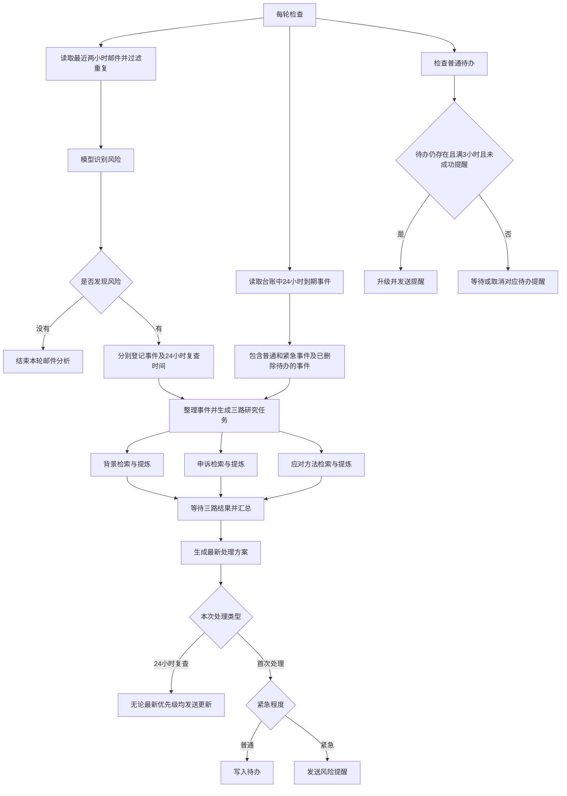

# 邮箱服务风险监测与应对助手

使用 LangGraph 读取最近两小时的 Gmail 邮件，识别海外服务的停用、取消或身份核验风险；每个事件分别研究背景、申诉和应对方法，生成中文方案。普通事项写待办，紧急事项可通过 Telegram 提醒；另有待办 3 小时升级提醒和事件 24 小时复查。

## 1. 安装

需要 Python 3.11 或更高版本，以及能够访问 Gmail、模型接口和 YouTube 的网络。下载完整仓库，在项目根目录运行 PowerShell：

```powershell
python -m venv .venv
.\.venv\Scripts\python.exe -m pip install -r requirements.lock.txt
if (-not (Test-Path .env)) { Copy-Item .env.example .env }
New-Item -ItemType Directory -Path credentials -Force | Out-Null
```

不需要下载 `external/` 中提到的上游源码，它们通过依赖安装。离线演示不需要填写任何接口凭据。

## 2. 填写本地配置

编辑项目根目录的 `.env`。模板为 `.env.example`，已有 `.env` 时不要覆盖；已有系统或终端环境变量优先于 `.env`。

| 配置项 | 填什么 |
| --- | --- |
| `LLM_BASE_URL` | 你自己的千问兼容接口基础地址，例如 `https://dashscope.aliyuncs.com/compatible-mode/v1`；不加 `/chat/completions` |
| `LLM_API_KEY` | 对应地址下可用的模型 API Key |
| `LLM_MODEL` | 该账号可用的模型名，默认 `qwen-flash`；当前适配器使用千问请求参数，更换其他厂商不保证兼容 |
| `TELEGRAM_BOT_TOKEN` | 你自己的 Telegram Bot Token |
| `TELEGRAM_CHAT_ID` | 接收提醒的用户或群组 Chat ID；与 Token 配套填写 |
| `GMAIL_CREDENTIALS_FILE` | 你自己的 Gmail 桌面应用 OAuth JSON 路径，模板为 `credentials/gmail-client.json` |
| `GMAIL_TOKEN_FILE` | 授权后自动保存的令牌路径，默认 `data/gmail-token.json`，不需要手填令牌 |
| `TODO_DIRECTORY` | 可选的待办目录，留空时使用项目的 `todos/`；可以改为自己的桌面目录 |
| `APPRISE_CONFIG` | 可选的额外通知配置文件路径，例如 `credentials/apprise.txt`，不用时留空 |

Gmail 使用 OAuth 登录，不是填一个普通 Google API Key。先在自己的 Google Cloud 项目启用 Gmail API、配置 OAuth，并创建“桌面应用”客户端，下载 JSON 到上述位置；测试应用还需将自己的邮箱加入测试用户。具体设置见 [Google 官方入门说明](https://developers.google.com/workspace/gmail/api/quickstart/python)。然后运行：

```powershell
.\.venv\Scripts\python.exe -m risk_monitor auth
```

在打开的浏览器中登录并允许 Gmail 只读访问，成功后程序保存令牌，之后通常不需重复授权。

`settings.toml` 用于调整并发、超时、邮件数量、模型调用预算和时间阈值。配置中的相对路径均相对于 `settings.toml`；命令行 `--data-dir` / `--todo-dir` 相对于当前终端目录，并优先覆盖对应目录。

## 3. 启动与停止

完成配置和首次 Gmail 授权后，使用下面的命令持续监测并实际发送提醒：

```powershell
.\.venv\Scripts\python.exe -m risk_monitor watch --interval 3600 --notify
```

启动后先检查一轮，此后每轮结束等待 3600 秒再检查。保持终端打开，按 `Ctrl+C` 停止；关闭终端、关机或进程异常退出后需要重新启动。当前不包含开机自启或异常退出后的自动重启。

每轮会读取邮件、处理风险事件，并检查 3 小时待办提醒和 24 小时事件复查。到期任务在下一轮检查时执行，停机超过两小时不会补读更早的邮箱邮件；此前已登记的事件和待办仍会继续检查。

| 命令或参数 | 用途 |
| --- | --- |
| `watch --interval 3600 --notify` | 持续运行，将提醒实际发送到配置的通知渠道 |
| `watch --interval 3600` | 持续运行，通知只保存在 `data/outbox/` |
| `poll` | 执行一轮邮件读取和到期检查后退出；可添加 `--notify` |
| `tick` | 只处理已有事件和到期提醒；可添加 `--notify` |
| `status` | 查看台账，不调用模型 |

以上子命令均接在 `.\.venv\Scripts\python.exe -m risk_monitor` 后。添加 `--notify` 才实际发送，此时需要 Telegram 或额外通知渠道的配置。

邮件正文会交给配置的模型分析。YouTube 搜索与字幕读取使用安装的工具，不另填 YouTube API Key。模型调用可能计费；未取得资料时保留失败说明，方案仍需自行核实。

## 4. LangGraph 工作流

下图展示新事件处理、待办提醒和 24 小时复查。复查从台账重新读取已登记事件，重新执行三路研究并生成方案，再发送更新。



- 一封邮件可识别出多个事件，分别处理；每个事件内部的背景、申诉、应对三路研究并行执行，汇总等待三路返回终态结果。
- 所有事件都登记到台账，初始普通和紧急事件均安排 24 小时复查；复查使用新一轮检索与方案生成，最新优先级为普通时也发送更新。
- 删除待办只取消对应的 3 小时升级提醒，不取消事件的 24 小时复查。当前每个事件安排一次 24 小时复查。
- 图中的三类检查是每轮要处理的工作；持续轮询由 `watch` 驱动，LangGraph 负责事件分发、三路并行与汇总、交付条件路由。

## 5. 离线演示与测试

```powershell
# 不读取真实邮箱、不调用外部服务、不发送通知
.\.venv\Scripts\python.exe -m risk_monitor run --model demo --research fixture --data-dir data-demo --todo-dir data-demo/todos

.\.venv\Scripts\python.exe -m pytest -q
```

`run` 默认读取 `examples/incidents.json` 中的虚构事件；`--model demo` 使用模拟模型，`--research fixture` 使用仓库中的演示资料。真实邮箱入口 `poll/watch` 使用真实时钟和模型。

## 本地文件

`.env`、`credentials/`、`data/`、`data-*/`、`todos/` 和 `.venv/` 均已忽略，不上传 Git。额外配置文件请放到 `credentials/`；自定义其他输出目录时自行加入 `.gitignore`。

流程与代码说明见 [工作流设计](docs/workflow-design.md) 和 [实现记录](docs/runtime.md)。
