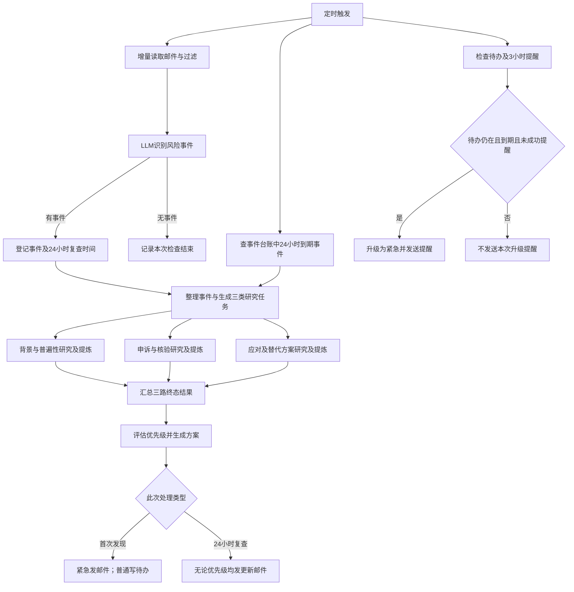

# 邮箱服务风险监测：流程与节点设计

记录日期：2026-10-20。当前为接口和流程草案，不表示任何功能已实现。

## 1. 项目目标

定时检查邮箱，识别海外服务的取消、停用、封号或身份核验通知；针对事件并行研究背景、申诉和应对方法，形成方案，并通过邮件和指定待办目录交付。

当前先走读设计，之后用户明确要求时再逐个搭建节点。不要自行接入服务、适配 SDK、安装环境或发送通知。

## 2. 已确认的两条独立时间机制

### A. 待办存在时，3 小时后升级提醒

- 普通事项写入指定待办目录。
- 经过 3 小时后，该待办仍存在，则升级为紧急并向使用者发送邮件。
- 用户在此之前删除待办，只取消这条待办对应的 3 小时升级提醒。
- 复查侧或用户所说“代码里”的记录被删除，不能自动取消仍然存在的待办的升级提醒。
- 建议记录是否已经成功发送升级邮件，成功后不在每次扫描时重复发送。
- 初始已紧急事项按原流程发送邮件；是否还需重复 3 小时提醒，尚未确认，不能默认新增。

### B. 每个事件都在 24 小时后重新查询并发送更新

- 初始普通和初始紧急事件都进入事件记录，安排 24 小时后复查。
- 待办文件是否存在，不是复查条件。即使用户删除待办，24 小时复查仍必须执行。
- 复查重新进入事件信息整理、三类研究任务生成、三路检索与提炼、汇总和方案生成。
- 每个事件完成本轮 24 小时复查后，都需要发送最新邮件，不因最新优先级为普通而改成仅写待办。
- 用户此前提过更新邮件成功后清理记录，但具体删哪些对象存在歧义，尚未定案。不得按“删待办”推断为取消复查。
- 是否在首次复查后继续每 24 小时循环，尚未确认；当前至少保留每个事件一次到期复查的要求。

### 时间与计数

用户最新纠正按“3 小时”和“24 小时”描述，因此本草案采用经过时间作为业务条件。
初始讨论中的启动次数或初始值 0 可作为运行统计，不能直接代替时间阈值。
若调度间隔为 10 分钟，启动 3 次并不等于 3 小时，启动 24 次也不等于 24 小时。

建议的时间起点（实现前可调整）：

- `escalate_at = todo_created_at + 3 小时`。
- `refresh_due_at = incident_detected_at + 24 小时`。
- 调度器在下一次正常执行时处理已到期任务；实际触发可能晚于阈值，不能宣称精确到秒。

## 3. 不互相替代的记录职责

以下是逻辑职责，不要求现在选数据库或物理目录结构。

| 对象 | 保存什么 | 删除或状态变化的影响 |
| --- | --- | --- |
| 事件台账 | 所有事件的原始证据、稳定 event_id、识别时间、复查到期时间 | 24 小时复查的依据；不能依赖待办文件是否存在 |
| 用户可见待办 | 事项说明、处理方案及关联 event_id | 用户删除它，只取消对应 3 小时升级提醒 |
| 待办提醒记录 | 文件定位、创建时间、升级到期时间、发送结果 | 负责 3 小时提醒；不因复查工作条目被移除而级联删除 |
| 复查工作记录 | 本轮复查状态、三路研究结果、更新邮件结果 | 移除工作条目不应被误解为待办已处理；事件仍在台账时应能识别未完成复查 |

台账保存原始事件；研究和提醒记录引用 event_id，不各自重新定义事件内容。
不要求同一份计数同时承担待办升级与事件复查，也不通过频繁改文件名表达状态。

“代码里的删除”暂按用户原话保留：已确认它不取消待办侧提醒；具体操作对象待明确。
如果永久删除唯一事件内容，就无法再保证复查；目前没有把这种删除定义成允许的业务操作。

## 4. 顶层流程

一次定时触发可以分别检查三类工作，三者不能互相作为前置条件：



`initial` 与 `refresh` 是本次任务类型，不是事件是否存在的两套定义；两者复用相同研究流程。
复查不应默认重建已被用户删除的待办，否则会无意恢复已取消的 3 小时提醒。

## 5. 节点目录与检查条件

| 节点 | 输入 | 输出或动作 | 进入/检查条件 |
| --- | --- | --- | --- |
| 定时入口 | 调度配置 | 本轮运行上下文 | 到达检查时机；间隔待配置 |
| 邮件读取 | 上次读取游标 | 新邮件、候选新游标 | 正常邮箱检查；不每轮重读全邮箱 |
| 垃圾与重复过滤 | 新邮件及处理记录 | 候选邮件、忽略原因 | 默认只跳过，不删除原邮件 |
| 邮件分析 LLM | 邮件正文和必要元信息 | 零到多个风险事件 | 邮件通过过滤；明确“邮件声称”和“已核实” |
| 事件登记 | 风险事件 | event_id、识别时间、复查时间 | 新事件登记；重复邮件不能重置原到期时间 |
| 研究任务生成 LLM | 事件与原始证据、initial/refresh | 三个定向研究任务 | 初次研究或24小时到期复查 |
| 背景研究 | 服务名及事件问题 | 背景证据或失败说明 | 与另两路并行；查是否普遍发生 |
| 申诉研究 | 服务名、申诉/核验问题 | 申诉步骤及来源 | 与另两路并行 |
| 应对研究 | 服务名、应对/替代问题 | 处理办法及来源 | 与另两路并行 |
| 提炼节点（三路复用） | 当前分支收集的资料 | 摘要、步骤、来源、限制 | 收集结束；不把无结果当成功证据 |
| 汇总节点 | 三个分支的终态结果 | 合并的证据上下文 | 三路均已成功、无结果、失败或超时，不无限等待 |
| 方案 LLM | 原事件、研究摘要和来源 | 紧急程度、理由、处理方案 | 汇总结束；不拼接全部中间提示词代替证据 |
| 初次交付路由 | 初次方案 | 紧急通知或普通待办 | 仅 initial 任务；所有事件已经登记台账 |
| 待办写入工具节点 | event_id、说明、方案 | 文件路径、创建结果、提醒到期时间 | 初次普通事项；用户目录待配置 |
| 待办检查工具节点 | 独立提醒记录及关联文件 | 存在/不存在/无法读取 | 每轮扫描；无法读取不当成用户删除 |
| 3小时升级节点 | 提醒记录、检查结果 | 紧急提醒发送请求 | 普通事项、文件仍在、当前时间达到到期时间、未成功提醒 |
| 24小时到期查询 | 事件台账 | 本轮需复查事件 | 到期且本轮未完成；不检查待办是否存在 |
| 更新交付节点 | refresh方案 | 更新邮件发送请求 | 所有完成本轮复查的事件，不按普通/紧急过滤 |
| 发邮件工具节点 | 固定配置收件人、标题、内容、去重标识 | 明确的发送成功/失败回执 | 来自已确定的通知路由，不让外部文本自行选择收件人 |
| 结果记录节点 | 文件或邮件操作回执 | 对应操作状态 | 只在工具确认成功后记录已完成；失败保留待处理状态 |

初次发现明显紧急风险时是否先发简短告警、研究后再补完整方案，是建议方案，尚未作为用户必须需求。

## 6. 调用节点的大致工具接口

以下签名仅用于以后选工具和搭节点；不依赖某个邮箱商、模型商或字幕服务，也不是可执行代码。

```text
mailbox.list_new(cursor, limit) -> MailBatch(messages, next_cursor)
mailbox.get_content(message_id) -> MailContent

incident_store.register_or_update(incident) -> IncidentRecord
incident_store.list_refresh_due(now) -> list[RefreshTask]
incident_store.record_refresh_result(event_id, refresh_id, result) -> RecordReceipt

todo.create(event_id, configured_directory, content) -> TodoReceipt(path, created_at)
todo.inspect(path) -> TodoInspection(exists | missing | unreadable)
reminder_store.list_due(now) -> list[TodoReminder]
reminder_store.record_delivery(reminder_id, receipt) -> RecordReceipt

research.collect(query, purpose, limits) -> ResearchMaterials
youtube.search(query, max_videos) -> list[VideoSource]
youtube.get_transcript(video_id, languages) -> TranscriptResult

notification.send_email(configured_recipient, subject, body, dedupe_key) -> SendReceipt
```

`research.collect` 可以集成多个工具。若已有“一次搜索并返回字幕”的工具，可接在这个接口后面，不强制拆成两个外部服务。
Youtube字幕并不保证对任意视频可得；每个结果必须能表达无字幕、无权限或工具失败。具体工具和可用范围以后再核实。

需要模型的接口：

```text
analyze_mail(mail) -> list[IncidentCandidate]
plan_research(incident, original_evidence, run_kind) -> ResearchPlan
distill(materials, research_goal) -> ResearchBrief
compose_solution(incident, briefs) -> Solution(priority, reasons, actions, sources)
```

定时检查、到期判断、文件存在检查、发送是否成功等使用确定性代码，不需要额外增加 LLM。

## 7. 三路研究的共同输出

- 研究方向：background / appeal / response。
- 结束状态：success / empty / failed / timed_out。
- 结论和可执行步骤。
- 来源 URL、发布日期、字幕时间点（若有）。
- 适用条件、矛盾证据与不确定性。

每路设置结果数量和时间上限，具体数值待后续选工具时决定。
建议官方公告、帮助文档与申诉入口作为重要依据；视频用于补充经验，不把个案当官方承诺。

## 8. 独立机制的手工验收场景

这些是未来实现时的条件检查，不在当前实际执行。

| 情况 | 3小时升级提醒 | 24小时复查与更新邮件 |
| --- | --- | --- |
| 普通事项，待办一直存在 | 到期后发送一次 | 必须执行 |
| 普通事项，用户在3小时前删除待办 | 不发送 | 仍然必须执行 |
| 普通事项，待办存在，但复查队列工作条目被移除 | 不因此取消 | 台账中未完成复查不能静默丢失；具体删除操作待明确 |
| 初始就紧急 | 初次按原流程通知；额外3小时重复提醒未定 | 必须执行 |
| 3小时提醒已发送，后来删除待办 | 不再重复升级提醒 | 仍然必须执行 |
| 到期时文件无法读取 | 不判为已删除，记录异常 | 不受影响 |
| 研究一路失败 | 与待办提醒相互独立 | 汇总已取得证据并标明缺失；不能无限等待 |
| 发送更新邮件失败 | 与待办提醒相互独立 | 不标记更新已成功，不提前清理；保留重试依据 |

## 9. 以后搭建时的顺序

按完整功能块逐步落地，不要求每个字段单独停一轮：

1. 明确邮箱、模型、待办目录、通知收件人，以及本节待明确项。
2. 定义事件、待办提醒和复查任务的接口与记录责任。
3. 邮件读取、过滤、分析、事件登记和首次交付流程。
4. 独立的待办存在检查与3小时升级通知。
5. 三路研究工具、提炼与汇总，先可用固定资料走读接口。
6. 24小时到期查询复用研究流程，完成更新邮件和结果记录。
7. 最后再接实际定时器，检查重复触发、失败重试与两条机制互不取消。

只有用户明确要求开发后才开始这些步骤；当前不安装工具、不跑代码、不创建实际自动化。

## 10. 尚待明确，不能擅自补成需求

1. “代码里的删除”具体指删除哪个对象或执行哪个动作？已确认其不能取消仍存在待办的3小时提醒。
2. 24小时复查是每个事件一次，还是此后持续每24小时复查？
3. 更新邮件发送成功后具体清理什么：本轮工作条目、提醒记录、待办还是事件记录？不要默认级联删除。
4. 原来提到“初始值0、启动次数累加”，目前如何保留为统计；业务阈值暂按最新的3小时/24小时表述。
5. 初始紧急事项是否也创建用户可见待办？是否需要额外3小时重复提醒？
6. 三路研究超时或证据不足时，更新邮件内容和重试策略如何取舍？

这些问题不阻碍当前把框架记录下来；实现相应节点前再按用户意图确认。
